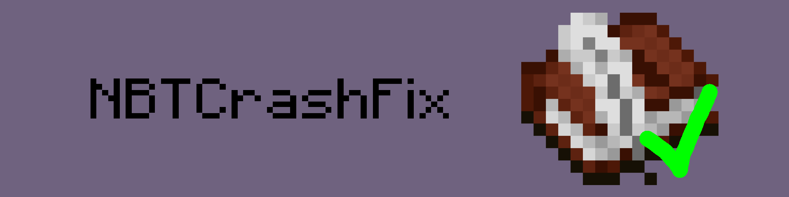

## NBTCrashFix!

NCF is a dead-simple mod that prevents you from crashing upon consuming packets containing malformed NBT data. Additionally, in version 1.2.0, all item frames are highlighted to you as it's the most common method of constantly crashing people. It cannot be turned off, and that's 'cause I'm too lazy to add a config as it's multiloader. Use version 1.1.0 if you do not want this.

## Why?

Specifically, in Hypixel Housing, some players found a way to create written books with malformed data, which crashes anyone above a certain version. It's pretty lame and the devs haven't fixed it yet :/
